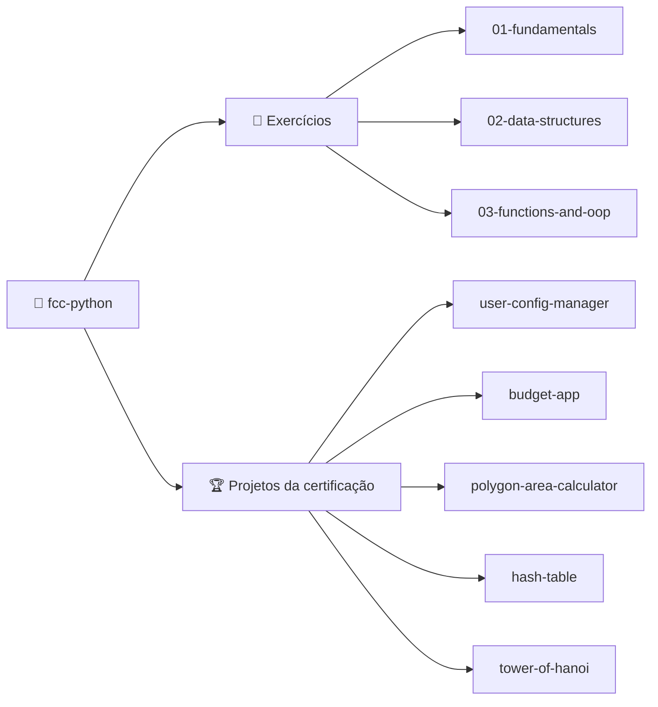

<div align="center">

# 🐍 fcc-python

### Códigos do curso de Python do freeCodeCamp

Exercícios e projetos da certificação, tudo em um só lugar.

<br>


<br>

[📂 Estrutura](#-estrutura-do-repositório) •
[🏆 Projetos](#-projetos-da-certificação) •
[🚀 Como começar](#-como-começar) •
[📄 Licença](#-licença)

</div>

---

## 📌 Sobre

Este repositório reúne os **códigos** desenvolvidos durante o
**curso de Python do [freeCodeCamp](https://www.freecodecamp.org/)**,
incluindo exercícios e os projetos da certificação.

> [NOTE]
> Este repositório contém apenas código. Não há material teórico nem anotações.

---

## 🧭 Visão geral



---

## 📂 Estrutura do repositório

```text
📦 fcc-python
├── 📁 01-fundamentals
├── 📁 02-data-structures
├── 📁 03-functions-and-oop
├── 📁 certification-projects
│   ├── 📁 user-config-manager
│   ├── 📁 budget-app
│   ├── 📁 polygon-area-calculator
│   ├── 📁 hash-table
│   └── 📁 tower-of-hanoi
├── 📄 .gitignore
├── 📄 LICENSE
├── 📄 README.md
└── 📄 requirements.txt
```

| 📁 Pasta                 | 📝 Conteúdo                                       |
| ------------------------ | ------------------------------------------------- |
| `01-fundamentals`        | Variáveis, tipos, condicionais e laços de repetição |
| `02-data-structures`     | Listas, dicionários, tuplas e conjuntos           |
| `03-functions-and-oop`   | Funções e programação orientada a objetos         |
| `certification-projects` | Projetos exigidos para a certificação             |

---

## 🏆 Projetos da certificação

| Status | Projeto                         | Pasta                                                                        |
| :----: | ------------------------------- | ---------------------------------------------------------------------------- |
|   ⬜   | Gerenciador de configuração de usuário | [`user-config-manager`](certification-projects/user-config-manager)   |
|   ⬜   | App de orçamento                | [`budget-app`](certification-projects/budget-app)                            |
|   ⬜   | Calculadora de área de polígono | [`polygon-area-calculator`](certification-projects/polygon-area-calculator)  |
|   ⬜   | Tabela hash                     | [`hash-table`](certification-projects/hash-table)                            |
|   ⬜   | Torre de Hanói                  | [`tower-of-hanoi`](certification-projects/tower-of-hanoi)                    |

> **Legenda:** ⬜ pendente · 🟨 em andamento · ✅ concluído

**Progresso:** `░░░░░░░░░░` 0 / 5

- [ ] Gerenciador de configuração de usuário
- [ ] App de orçamento
- [ ] Calculadora de área de polígono
- [ ] Tabela hash
- [ ] Torre de Hanói

---

## 🚀 Como começar

### 📋 Requisitos

- 🐍 **Python** 3.12 ou superior
- 📦 **pip** atualizado
- 🔧 **Git**

### ⚙️ Instalação

**1. Clone o repositório**

```bash
git clone https://github.com/dexthw/fcc-python.git
cd fcc-python
```

**2. Crie e ative um ambiente virtual**

```bash
python -m venv .venv
```

| 💻 Sistema       | ⌨️ Comando de ativação          |
| ---------------- | ------------------------------- |
| Linux / macOS    | `source .venv/bin/activate`     |
| Windows (CMD)    | `.venv\Scripts\activate.bat`    |
| Windows (PS)     | `.venv\Scripts\Activate.ps1`    |

**3. Instale as dependências**

```bash
pip install -r requirements.txt
```

### ▶️ Executando um projeto

```bash
python certification-projects/tower-of-hanoi/main.py
```

<details>
<summary><b>🧪 Executar os testes</b></summary>

<br>

```bash
python -m unittest discover -s certification-projects/tower-of-hanoi
```

</details>

---

## 📄 Licença

Distribuído sob a licença **MIT**. Veja o arquivo [`LICENSE`](LICENSE)
para mais detalhes.

---

<div align="center">

### 👤 Autor

**Matheus Brasil**

[](https://github.com/dexthw)

<br>

⭐ Se este repositório foi útil, deixe uma estrela!

</div>